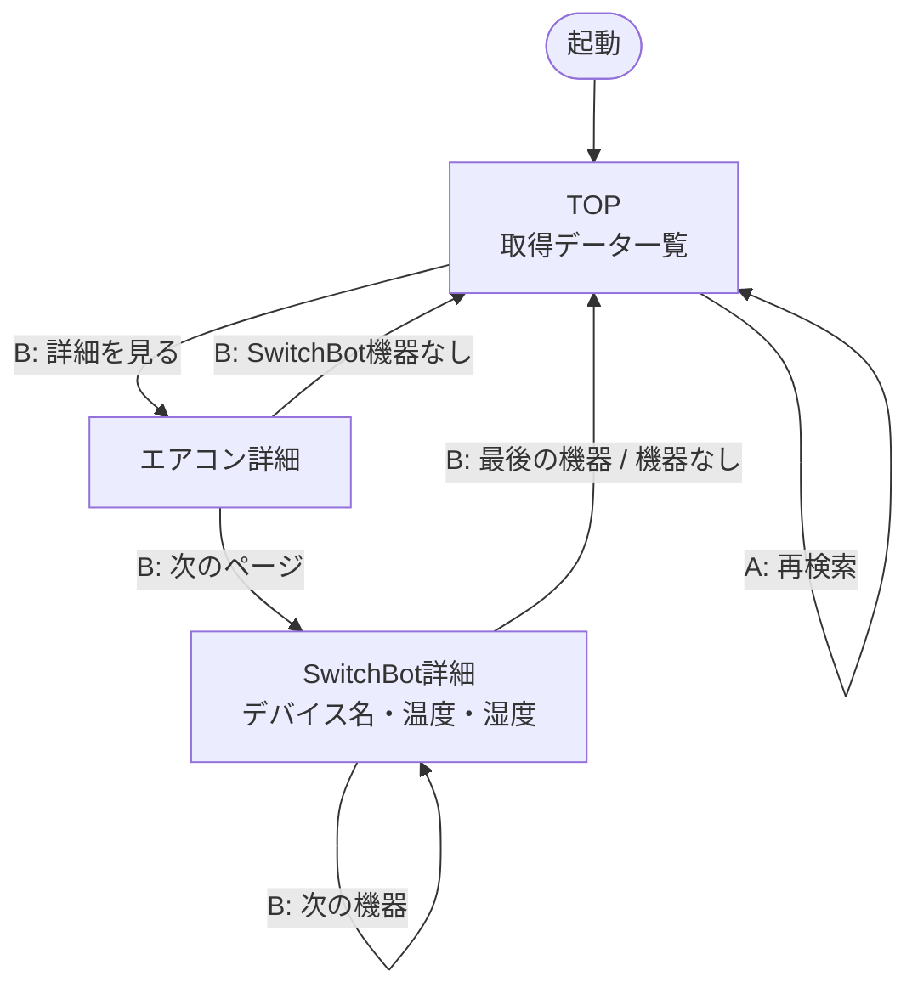
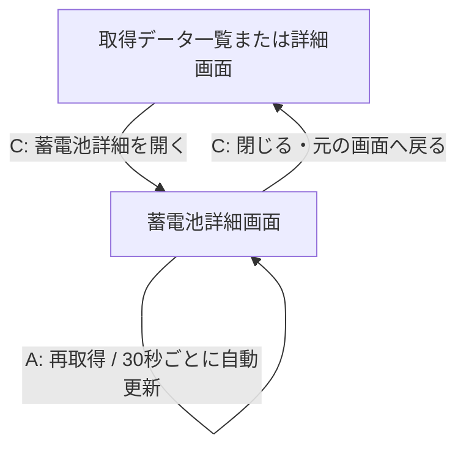

# room-eco-monitor

## Room data collection

### M5Stackの処理フロー

```text
起動
  ↓
setup(): 画面・シリアル初期化 → Wi-Fi接続 → 時刻・LittleFS・HTTP 80・UDP 3610初期化
  ↓
sendNodeSearch()でノード検索 + sendAcRequest()でエアコンGET要求
  ↓
loop()
  ├─ receivePackets() → logPacket(): UDP応答を解析し、ノード一覧やエアコン値を更新
  ├─ LAN内からのGET /data.json要求にLittleFSの保存データを応答
  ├─ 通常画面では30秒ごとにsendNodeSearch()を実行
  ├─ 起動直後と以後5分ごとにデータ収集・記録
  │    ├─ sendAcRequest()でエアコン情報を取得
  │    ├─ switchBotGet()でSwitchBot APIから対応機器の温度・湿度を取得し、CO2センサーからはCO2濃度も取得（認証設定時）
  │    ├─ appendRoomRecord()で未送信レコードをLittleFSの/data.jsonへ追加
  │    └─ 日付変更後、完了日分をdata_YYYYMMDD.jsonとしてGitHubへ送信
  └─ ボタン入力に応じて検索、取得データ一覧・詳細ページ切り替え、蓄電池詳細を操作
```

- ノード検索はUDPポート`3610`からマルチキャストで行います。蓄電池詳細画面では検索しません。
- データ収集は起動時に一度実行し、その後は5分間隔です。エアコンのGET要求もこのタイミングで送信します。
- GitHubへのアップロードはJSTで日付が変わった後、最初の記録タイミングで行います。日付ごとのファイルを送信し、成功した日付のレコードだけLittleFSから削除します。通信に失敗したデータは保持し、次の記録タイミングで再試行します。
- システム時刻が未同期の場合は、時刻不明の測定レコード全体を保存せず、GitHubにも送信しません。シリアルログにスキップ理由を出力します。
- 起動時にLittleFSの`/data.json`から`"timestamp": "Time not synced"`のレコードとSwitchBotの機器名を削除します。整理したJSONは日付別の定期アップロード時に反映します。
- SwitchBot認証情報が未設定の場合、SwitchBot APIの呼び出しを省略します。
- SwitchBotの再取得に失敗した場合は直前に取得した機器・測定値を保持し、失敗理由をシリアルログに出力します。
- GitHubリポジトリ名またはトークンが未設定の場合、記録はCore2内のLittleFSに保存し、GitHubへの送信は省略します。
- LittleFSの`/data.json`は、同じLAN内のPCから`http://<M5StackのIPアドレス>/data.json`でダウンロードできます。起動時にシリアルへURLを出力します。
- `data.json`はJSON形式を保ったまま、Python処理・M5Stack処理の両方で4スペースのインデントを付けて保存します。YAML風に読みやすく整形されますが、拡張子・データ形式はJSONのままです。
- HTTP取得は同一サブネットからのGETだけを許可します。認証やHTTPSは使用しないため、信頼できるLAN内でのみ使用し、ルーターでポート転送を設定しないでください。IPアドレスが変わらないよう、必要に応じてルーターでDHCP予約してください。
- TOP画面には取得済みエアコンの概要と、SwitchBot各機器のデバイス名・温度・湿度を一覧表示します。
- TOP画面でBを押すとエアコンの詳細ページへ進み、続けてSwitchBot各機器の詳細ページを表示します。最後の詳細ページの次にBを押すとTOP画面へ戻ります。
- エアコン詳細には運転状態、室温、湿度、外気温、消費電力、積算電力量、運転モード、設定温度、風量、節電状態を表示します。値はECHONET Lite応答を受け取ると更新されます。
- SwitchBot詳細ページにはデバイス名、種類、ID、温度、湿度を表示します。SwitchBot認証情報が未設定、または対応機器がない場合はTOP画面にエアコンの概要のみ表示します。
- TOP・測定値画面ではAで再検索、Cで`enterBatteryDetails()`による蓄電池詳細画面を開きます。蓄電池詳細画面では`sendBatteryGet()`で30秒ごとに値を更新し、Aで再取得、Cで直前の画面へ戻ります。蓄電池GET応答の値は`updateBatteryProperty()`で変換します。

### ソース構成

M5Stack向けC++ソースは機能ごとに分割しています。

| ファイル | 担当機能 |
| --- | --- |
| `src/main.cpp` | `setup()`による起動処理と`loop()`による定期処理・ボタン操作 |
| `src/app_state.h` / `src/app_state.cpp` | 画面状態、通信状態、計測値など複数機能で共有するデータ |
| `src/display.cpp` / `src/display.h` | 状態表示、オブジェクト一覧、取得データ一覧・詳細、蓄電池詳細の描画 |
| `src/echonet.cpp` / `src/echonet.h` | ECHONET Liteの検索・GET送信、UDP受信と応答解析 |
| `src/battery.cpp` / `src/battery.h` | 蓄電池GET要求、応答値の変換、画面遷移 |
| `src/switchbot.cpp` / `src/switchbot.h` | SwitchBot API認証、機器一覧・温湿度の取得 |
| `src/room_data.cpp` / `src/room_data.h` | エアコン・SwitchBotデータの記録、LittleFS保存、GitHub連携 |
| `src/room_data_server.cpp` / `src/room_data_server.h` | LAN内PC向けの保存JSONダウンロード（HTTP GET） |
| `src/encoding.cpp` / `src/encoding.h` | SwitchBot署名とGitHub連携で共有するBase64変換 |
| `src/app_config.h` | `secrets.h`の読み込みと設定値の既定値 |

### 画面表示仕様

画面は3ボタンを下にした向きで表示し、従来の向きから左へ90度回転しています。画面下部の操作表示は表示方向に合わせて下端へ配置します。

| 画面 | 表示内容 |
| --- | --- |
| TOP（取得データ一覧） | `Room data (M5StackのIPアドレス)`の見出し、エアコンの運転状態・室温・湿度・消費電力の概要、SwitchBot各機器のデバイス名・温度・湿度。デバイス名は日本語も表示 |
| エアコン詳細 | エアコンの応答元IPアドレス、運転状態、室温、湿度、外気温、消費電力、積算電力量、運転モード、設定温度、風量、節電状態、ページ番号、ボタン操作 |
| SwitchBot詳細 | ページ番号、デバイス名（日本語対応）、機器種類、機器ID、温度、湿度。1ページに1台を表示 |
| 蓄電池詳細 | 対象IPアドレス、読み出し状態、運転状態、運転モード、残量、充電・放電積算電力量、蓄電池種類、充電・放電設定値、最終更新時刻、ボタン操作 |

取得前の項目は`--`などの未取得表示になります。蓄電池詳細画面の読み出し状態には、要求中・更新済み・送信失敗などが表示されます。

### 画面遷移フロー

通常画面の移動と蓄電池画面の操作を分けて表示しています。



蓄電池画面への遷移と戻り方：



蓄電池画面はオブジェクト一覧の応答から蓄電池が見つかった場合にCボタンで開けます。取得データ一覧・詳細画面は、受信したエアコン応答と定期収集したSwitchBot値に応じて更新します。画面遷移は`loop()`、データ表示は`showMeasurementsPage()`が担当します。

1. Copy `include/secrets.h.example` to `include/secrets.h`.
2. Set Wi-Fi, air-conditioner, SwitchBot, and optional GitHub values.
3. Build and upload with PlatformIO for the `m5stack-core2` environment.
4. Use serial baud 115200 for logs.

### PCへのJSONダウンロード

M5StackとPCを同じLANに接続し、シリアルログに表示されるURLをブラウザーで開きます。例：

```text
http://192.168.11.45/data.json
```

PowerShellから保存する場合：

```powershell
curl.exe --output data.json "http://192.168.11.45/data.json"
```

IPアドレスは環境によって異なります。HTTPサーバーはポート`80`で起動し、`/data.json`へのGET以外は受け付けません。

### GitHub Pagesでのグラフ表示

リポジトリ直下の`index.html`は、表示期間に応じて`data_YYYYMMDD.json`を直接読み込み、レコードを統合してPlotly.jsでグラフを表示します。GitHub APIや`data-index.json`は使用しません。全期間表示は`dashboard.js`の最初の日付`2026-11-22`からファイル名を列挙します。全機器の温度とエアコンの外気温・消費電力・設定温度・ファン速度設定値を1つにまとめた総合グラフも表示します。総合グラフは運転中を薄緑、停止中を薄灰色の背景で示し、運転状態不明の区間や30分以上データが空いた区間は塗りません。運転状態の詳細は専用グラフで確認できます。温度・湿度・CO2濃度のグラフには、表示用の外れ値フィルターが適用されます。JSON原本は変更しません。

- エアコン温度はECHONET Liteの有効値範囲`-127〜125°C`、湿度は`0〜100%`、SwitchBot CO2センサーのCO2値は公式APIの`0〜9999 ppm`を範囲外として表示しません。SwitchBot温度・湿度は公式に一律の測定範囲を確認できないため、推測の上下限を設けません。
- 直近3回の有効値の中央値から、温度が3°C、湿度が15ポイント、CO2が300 ppmを超えて離れた値は一旦非表示にします。新しい水準の値が3回続いた場合はその変化を表示し、30分以上記録間隔が空いた場合は判定履歴をリセットします。
- 設定温度、消費電力、積算電力量、運転状態はフィルター対象外です。CO2値はMeter Pro CO2の状態APIから取得されるため、過去レコードには存在せず、新たに記録されたデータからグラフに表示されます。

GitHubで次のように設定してください。

1. `Settings` → `Pages`を開きます。
2. `Deploy from a branch`を選び、公開するブランチとフォルダー`/(root)`を指定します。
3. 公開URLを開くと、エアコンの温度・湿度・消費電力・運転状態と、選択したSwitchBot機器の温湿度を確認できます。

表示期間と温湿度グラフのSwitchBot機器を選択できます。総合グラフには全機器の温度を表示し、CO2グラフにはCO2センサーの測定値を表示します。総合グラフは温度・消費電力・ファン速度設定値ごとに縦軸を分け、運転状態は背景色で示します。状態の詳細は専用グラフで確認できます。グラフ上で拡大・縮小できます。ホバー時刻とグラフ下の時刻軸はJSONの`timestamp`と同じ`YYYY-MM-DD HH:mm`形式で表示します。JSONは同じサイトから取得し、1分ごとに再読み込みします。追加のビルド手順やアプリ用GitHub Actionsは不要です。

GitHub Pagesで公開したファイルは誰でも閲覧できます。日付別JSONにはSwitchBotの機器IDと、機器名の代わりに設定した表示ラベル（例：`1F_リビング`、`下_temp`）が含まれます。IDも公開したくない場合は公開前に匿名化してください。

`include/secrets.h` is excluded from Git. The GitHub and SwitchBot credentials
must be kept secret and should not be committed.